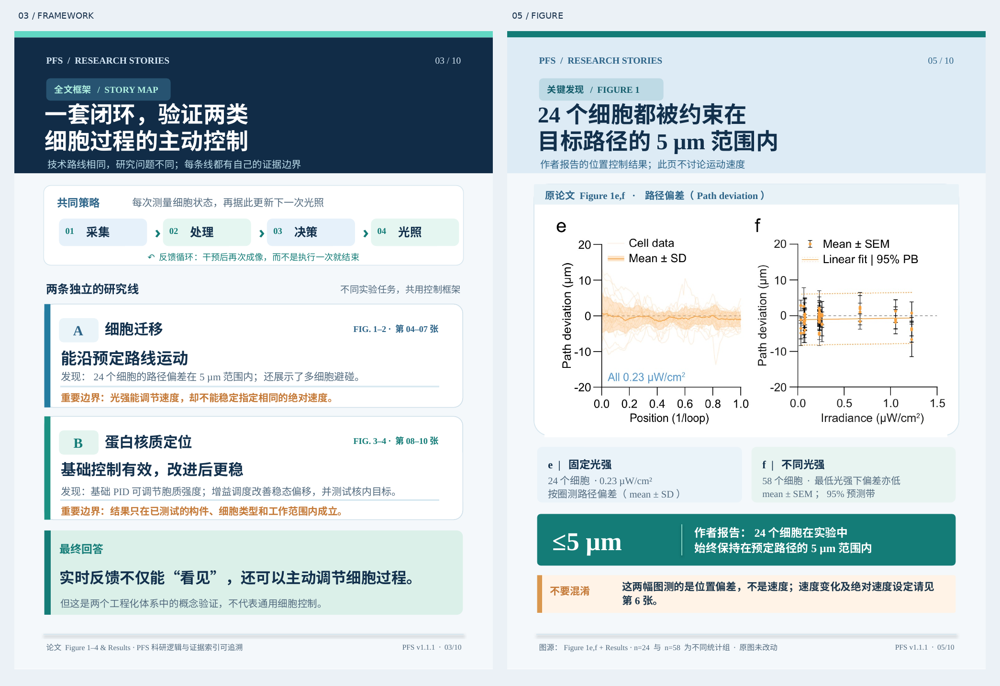
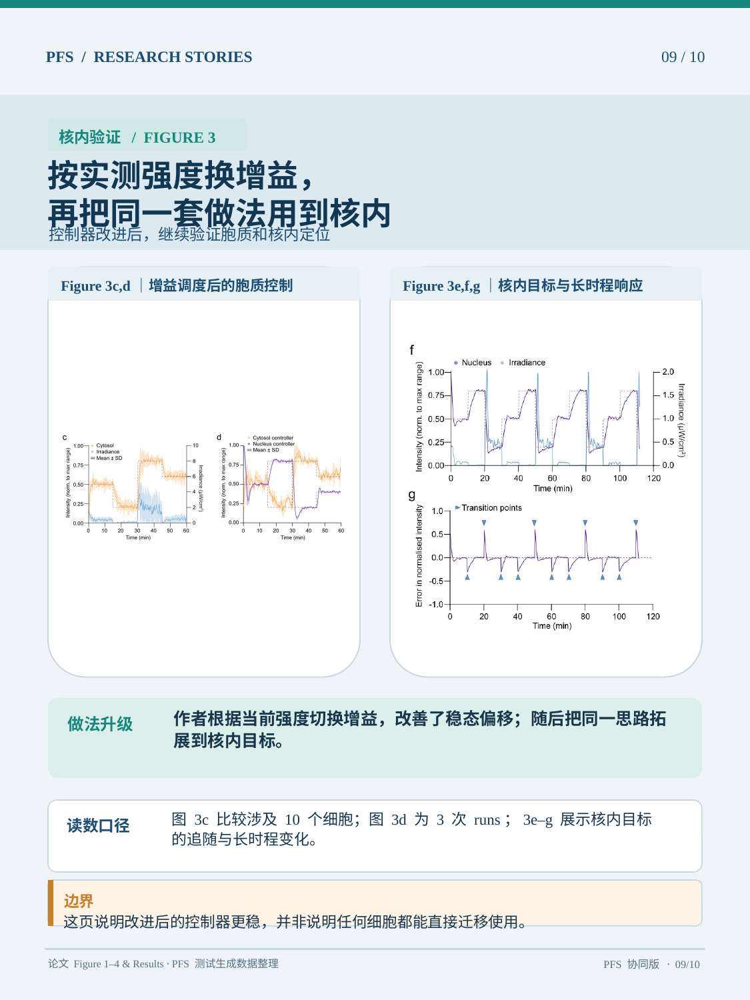

# Paper Figure Story · SharePack

**把科研论文变成清楚、真实、可追溯的图文故事。**  
*Figure-grounded, editable research storytelling. PFS is optional.*

> **v0.1.0-rc.1 · Experimental pre-release** — This repository contains executable experimental code, not a one-click PDF-to-verified-conclusions product. Cross-paper tests and a clean Windows install remain pending; see [limitations](docs/KNOWN_LIMITATIONS.md).

## 真实作品展示｜优先使用排版清晰的截图

[](docs/images/standalone_design_reference.png)

**上图来自实际制作的PowerPoint页面**，不是AI概念渲染。其中左侧是研究框架卡，右侧是包含原论文 Figure 1e/f 的分析卡。它属于**独立模式倾向的设计参考**，不等同于通过跨论文盲测的独立模式交付。

### PFS 协同版：实际 Figure 证据卡

[](docs/images/protein_control.png)

**上图来自既有 PFS 协同十卡案例的第9页**，保留原论文 Figure 和结论边界，非自动复现通用能力的证明。

### 十卡历史交付与版本说明

[查看完整十卡总览（历史导出，部分页面有文字重叠）](docs/images/ten_card_overview.png) · [可编辑PPTX](demo/SharePack_PFS_10cards.pptx) · [PDF预览](demo/SharePack_PFS_10cards.pdf)

> **已知视觉缺陷：** 首次预发布的部分截图（特别是 `story_map.png`，以及 `path_deviation.png` 的局部）存在文字重叠，问题源于原始渲染文件，并非GitHub网页宽度所致。为避免误导，首页暂不内嵌这些有缺陷的截图；历史原件仍保留，待从可编辑源稿修复、重导并逐页视觉验收后更新。清晰的设计参考图不能用来冒充原十卡已修复。

[示例来源、版权及展示范围](docs/DEMO_PROVENANCE.md) · [已知限制](docs/KNOWN_LIMITATIONS.md)

## 核心用途

- **讲述完整故事**：科学问题 → 方法与对照 → 实际观察 → 发现与转折 → 结论及证据边界。
- **使用真实 Figure**：按审阅后的原论文panel裁图，不重新生成实验图或数据。
- **可编辑输出**：文字和图形保留 PowerPoint 原生对象；论文实验图为嵌入图片。
- **灵活排版**：标准版目标8–10页，完整版可扩至15页；不强制每页固定图数或框数。
- **来源追踪**：为图、关键数字、科学主张登记来源和检查状态。

## 两种工作模式

| 模式 | 输入 | 科研判断 | 需要PFS? |
|---|---|---|---|
| **Standalone** | 研究论文PDF及相关补充资料 | Agent/研究者实际阅读和审核，建立结构化故事 | **不需要** |
| **PFS-assisted** | PFS已生成的M1、Figure资产、可选Research Logic | 复用证据身份与关系，再进行科学转述和审核 | **可选** |

**独立模式不会自动安装或运行PFS**；PFS项目位于[paper-figure-story](https://github.com/Lu18835713910/paper-figure-story)，独立维护。

## 安装（开发者预览）

Python 3.10+。以下是当前源码的开发安装示例，尚未完成全新 Windows 机器验收。

```powershell
git clone https://github.com/Lu18835713910/paper-figure-story-SharePack.git
cd paper-figure-story-SharePack
python -m venv .venv
.venv\Scripts\Activate.ps1
python -m pip install -e .
sharepack --help
```

Windows PowerPoint不是创建PPTX的强制依赖；如需PNG/PDF，需安装可用的导出环境（如LibreOffice），并做人工视觉核验。

## 独立模式：真实工作流程

```powershell
sharepack prepare --pdf paper.pdf --outdir work/index
# Agent/研究者：实际审核原文、Figure、对照、统计口径，编写 story.json 与 regions.json
sharepack extract-regions --pdf paper.pdf --regions work/regions.json --outdir work/assets
sharepack audit-plan --story work/story.json --assets work/assets/assets.json --outdir work/audit
sharepack validate --story work/story.json --assets work/assets/assets.json
sharepack render --story work/story.json --assets work/assets/assets.json --outdir work/result --layout-engine freeform --no-pdf
```

**上述命令不会自动完成中间的科学审阅。** `prepare` 得到的是候选Figure索引，不是完整故事稿。`validate` 的结构PASS不是科学结论PASS。

## PFS协同：只读入口

```powershell
sharepack bridge-pfs --knowledge path/to/knowledge.json --outdir work/pfs_bridge
# 如有经核验的PFS Figure清单，可使用 --pfs-assets 及必要的 --pfs-crosswalk
# 再由Agent把PFS证据与Research Logic转换为经审阅的SharePack故事，运行validate/render
```

实验性A/B科研逻辑投影：见 `scripts/pfs_logic_projection.py` 与 `scripts/draft_ab_view_spec.py`。不得将M1关系列表当作完整PFS A/B。

## 当前版本边界

- 单篇Passmore等人论文的完整十卡是**经人工整理的实际案例**，不是新用户输入任意PDF就能复现的自动承诺。
- 已完成部分结构性回归测试；还需干净Windows安装、独立跨论文测试、双图移动端可读性和进一步科学审阅。
- 某些定量结论涉及暂未取得的补充图；不得把卡片中提示“正文报告”的数值升级为独立复算结果。
- Release图片来自第三方开放获取论文，请遵循[CC BY 4.0署名及改动说明](NOTICE_THIRD_PARTY.md)。
- **当前代码许可证尚未由所有者确定。** 公开可见不代表允许任意复制、修改或再分发代码；请先阅读[LICENSE_STATUS](LICENSE_STATUS.md)。

[测试与限制](docs/KNOWN_LIMITATIONS.md) · [发行说明](RELEASE_NOTES.md) · [第三方素材署名](NOTICE_THIRD_PARTY.md)
